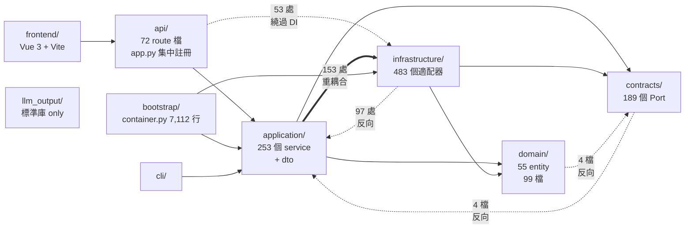

# Index

一頁全貌。要細節請進對應頁面。

## 全貌

實線是主要方向，虛線是實際存在但不該擴大的反向邊。完整證據見
[layers.md](layers.md)。

## 分層速查

| 我要 | 去哪 | 說明 |
|---|---|---|
| 找改動落點 | [change-map.md](change-map.md) | 12 條最常改動路徑 |
| 確認不能破的規則 | [invariants.md](invariants.md) | HARD / CONVENTION / BROKEN |
| 判斷該放哪一層 | [layers.md](layers.md) | 12 個套件職責 + 實際依賴 |
| 查專案詞彙 | [glossary.md](glossary.md) | 實體與概念的實際名稱 |
| 知道 Atlas 怎麼維護 | [README.md](README.md) | 慣例與 staleness 機制 |

## 領域

| 領域 | 頁面 | 狀態 |
|---|---|---|
| 聊天回合 / 路由 | `domains/chat.md`, `domains/routing.md` | **待寫**（change-map #1、#9 已涵蓋大部分） |
| Prompt 組裝 | `domains/prompt.md` | **待寫**（change-map #2、#3） |
| NSFW / 內容流 | [domains/nsfw.md](domains/nsfw.md) | ✅ |
| 排程與主動訊息 | `domains/scheduling.md` | **待寫**（change-map #4、#5、#6；行程與聊天回合的交互見 `flows/chat-turn.md`） |
| 記憶 | `domains/memory.md` | **待寫** |
| 角色與人物 | `domains/character.md` | **待寫** |
| 媒體生成 | `domains/media.md` | **待寫** |
| 可觀測性 | `domains/admin.md` | **待寫**（change-map #10、#12） |

領域頁刻意不齊。只有真正被動到、且 change-map 一列不足時才開新頁——
寧可少而準，不要多而腐。

## 流程

| 流程 | 頁面 | 狀態 |
|---|---|---|
| 聊天回合 | [flows/chat-turn.md](flows/chat-turn.md) | ✅（含「行程如何影響一個回合」：忙碌延後、行程 prompt 段、post-turn 改寫行程） |
| 主動訊息 | `flows/proactive-message.md` | **待寫** |

## 現有 reference 歸屬對照

根目錄 `*_REFERENCE.md` 是**單一改動**的設計文件，不是常駐地圖。下表說明每一份
目前對應到哪個領域，以及它的狀態——避免從舊文件讀到已失效的設計。

| Reference | 領域 | 狀態（2026-11-21） | Atlas 對應 |
|---|---|---|---|
| `AIRP_IMAGE_DELIVERY_SCOPE_REFERENCE.md` | media | 無 Status 段 | `change-map` #8 |
| `CHARACTER_VIDEO_PREVIEW_REFERENCE.md` | media | 進行中 | — |
| `COMMITMENT_RECONCILIATION_IMPLEMENTATION_REFERENCE.md` | scheduling | **source 已提交；migration 尚未執行** | `change-map` #6 |
| `CROSS_CHANNEL_ARC_PLANNER_REFERENCE.md` | story | 已提交 `300218c`，2026-08-31 部署 | `change-map` #7 |
| `DIAGNOSTIC_COMPLETENESS_IMPLEMENTATION_REFERENCE.md` | observability | 2026-10-15 | `change-map` #10 |
| `FIRST_MEETING_PREMATURE_COMPLETION_FIX_REFERENCE.md` | story | 進行中 | `change-map` #7 |
| `FIRST_MEETING_REASSESSMENT_REFERENCE.md` | story | 已批准，source 與資料未動 | `change-map` #7 |
| `ONGOING_INTERACTION_WRITEBACK_REFERENCE.md` | chat / scheduling | 設計完成，等待 owner 批准（I-21 第二期，2026-11-22） | `flows/chat-turn.md`、`change-map` #5 |
| `ONGOING_INTERACTION_HOLD_REFERENCE.md` | chat / scheduling | 第一期已發布 `2aa978a`（I-21，2026-11-22）；第二期未設計 | `flows/chat-turn.md`、`change-map` #2、#6 |
| `GENDER_AND_ADDRESS_SEPARATION_IMPLEMENTATION_REFERENCE.md` | character | **清單 1–12 在工作區完成；未 commit／未部署** | `change-map` #9 |
| `PENDING_FOLLOW_UP_ADMIN_CRUD_REFERENCE.md` | scheduling | 已批准並部署 | `change-map` #6 |
| `PLAYER_IDENTITY_AND_SETTINGS_PLACEMENT_REFERENCE.md` | character | **已發布** 2026-10-24（`32090f1`、`968a1bd`） | `change-map` #9 |
| `PROACTIVE_AUDIT_RECORDING_FIX_REFERENCE.md` | proactive | 進行中 | `change-map` #4 |
| `PROACTIVE_INTENTION_JUDGE_PROMPT_FIX_REFERENCE.md` | proactive | 進行中 | `change-map` #4 |
| `PROMPT_CUSTOMIZATION_IMPLEMENTATION_REFERENCE.md` | prompt | 進行中 | `change-map` #3 |
| `PROMPT_PLAYGROUND_IMPLEMENTATION_REFERENCE.md` | prompt | 進行中 | `change-map` #3 |
| `SAME_SPACE_DETAIL_GUIDANCE_REFERENCE.md` | prompt / chat | 已批准，source-only prompt 調整 | `change-map` #2 |
| `SAME_SPACE_DURABLE_CHAT_IMPLEMENTATION_REFERENCE.md` | chat | P5 完成，全域觀察窗口 | `change-map` #1、#9 |
| `VIDEO_PROVIDER_GENERATION_TEST_REFERENCE.md` | media | 進行中 | `change-map` #8 |
| `ARCHITECTURE_ATLAS_DESIGN_REFERENCE.md` | atlas 自身 | 進行中（本工作） | — |

標為「進行中」的是沒有明確 Status 結論段的文件；讀之前先確認它描述的設計是否
已經落地，不要假設。

## 開始改動前的五步

1. `git status` + 最新 commit — 確認工作區狀態。
2. `.codex-round.md` — 是否有未完成的任務、`Next action` 是什麼。
3. 本頁 `INDEX.md` — 定位領域。
4. [change-map.md](change-map.md) — 找到列，讀「不可違反」與「必跑測試」。
5. 只有在以上不足時，才讀 `src/` 原始碼。

第 5 步之前就跳去讀程式碼，是這個 atlas 想省下的成本。

## Atlas 自身狀態

| 頁面 | 狀態 |
|---|---|
| `README.md` | ✅ |
| `INDEX.md` | ✅ |
| `layers.md` | ✅ |
| `invariants.md` | ✅ |
| `change-map.md` | ✅ |
| `glossary.md` | ✅ |
| `domains/nsfw.md` | ✅ |
| `flows/chat-turn.md` | ✅ |
| 其餘 domain / flow 頁 | 待寫 |

驗證：`make atlas-check` 應回報所有頁面 0 error。

## 這次盤點挖出的缺陷

Atlas 的第一個產出不是文件，是三條具體發現：

1. **`scripts/check_clock_guard.py` 目前失敗** — exit 1，61 個未列入 allowlist
   的檔案，且不在 CI 裡跑。文件稱它守護新程式碼，實際上沒有。
2. **「恰好一個 Telegram polling owner」只存在於文件** — 程式只實作每帳號租約，
   N 個程序可以各自輪詢互斥的帳號子集。
3. **沒有機器強制的分層方向** — `application ↔ infrastructure` 雙向耦合，
   `contracts` 有 4 個檔反向 import `application`。

詳見 [invariants.md](invariants.md) §E、§H 與 [layers.md](layers.md) §已知缺口。
