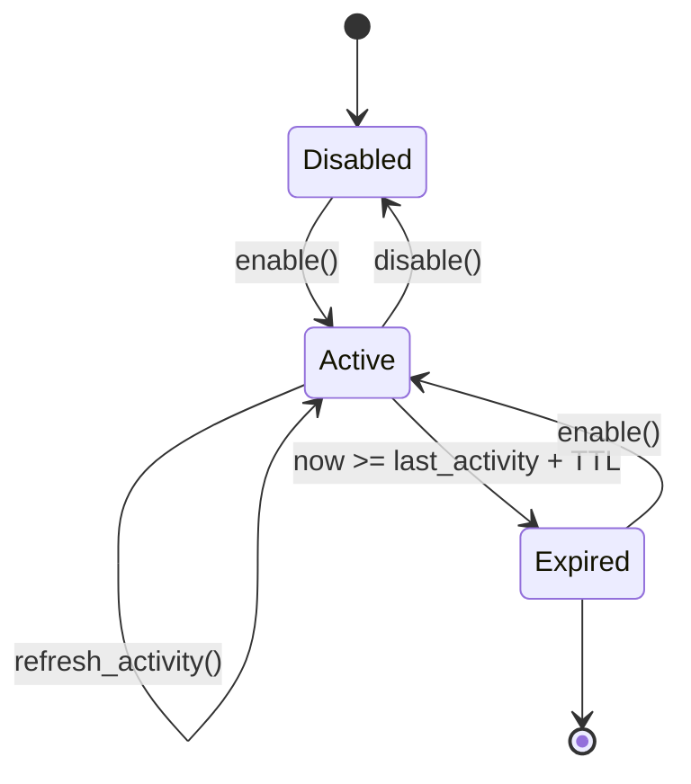

# NSFW／內容流

## 職責

把「這一則訊息屬於哪種內容流」變成一組**寫入時的事實標記**，並據此決定：

1. 這一回合由哪個 LLM provider／model 產生
2. 圖片生成走哪個 profile（或直接拒絕）
3. 歷史紀錄送往 frontier provider 前要不要清洗

核心立場：**不做內容偵測**。`content_flow.py` 檔頭明寫
「They do not inspect text content and must not grow keyword-based
detection.」。所有分流都建立在使用者手動開啟的 mode 上，不是對文字的推論。

## 不屬於這一層的事

- 任何形式的年齡驗證、同意確認、使用者資料標記 — 目前**不存在**。唯一的守門
  條件是「Admin 已配置 target」。
- 圖片內容審查。生成出的圖片不做二次檢查。
- 計費。摘要呼叫走 `FEATURE_NSFW_SAFE_SUMMARY`，計費機制屬 routing／usage 層。

## 三層狀態模型

| 層 | 範圍 | 存放 | 程式位置 |
|---|---|---|---|
| 使用者開關 | per-user | `preferences` 鍵 `nsfw_mode` | `nsfw_mode.py::_read` |
| Admin 目標 | 全站唯一 | `preferences` 鍵 `nsfw_mode_target` | `nsfw_mode.py::get_global_target` |
| 訊息標記 | per-message | `messages.content_mode` + `safe_summary` | `conversation.py` |

三層刻意分離。開關是個人狀態，路由目標是安裝層級設定，而「這則訊息屬於哪種
內容流」是不可回填的寫入事實。

## 生命週期

- TTL 預設 30 分鐘（`NSFW_MODE_DEFAULT_TTL_SECONDS`），下限硬夾 60 秒。
- **惰性判定**：沒有背景排程器打掃。`get_status()` 每次重算
  `last_activity_at + ttl < now`（`_status_from_raw`）。
- 每次寫入訊息時 `chat_service._content_mode_for_character` 會呼叫
  `refresh_activity()` 續命。
- 事件日誌（`enabled` / `disabled` / `expired`）只留最近 50 筆，
  以 `last_activity_at` 去重避免重複寫 expired（`_append_event_to_raw`）。
- `usage_metrics()` 從事件串流反推次數與平均開啟秒數。

## 路由優先序

`active_llm_provider.py` 在任何 feature 路由之前先問 NSFW。判斷只走
**單一 helper** `_nsfw_target_for(feature_key, character)`，四個分支點
（`resolve_model_id`、`_read_preferred_provider`、`_maybe_bind_reasoning`、
`_maybe_bind_vision`）都呼叫它，所以同一回合的 model、routing source 與
reasoning 不會來自不同 provider。

| 條件 | routing_source | 結果 |
|---|---|---|
| mode 開啟，feature **不在** `structural_features` | `nsfw_mode` | 用 target 的 provider/model |
| mode 開啟，feature **在** `structural_features` | 正常值（`active_model` 等） | 走正常路由 |
| feature 未列入（含日後新增） | `nsfw_mode` | 留在 target（fail-closed） |
| mode 關閉但訊息已標記 | `nsfw_content` | 改用**已配置但未啟用**的 target |
| target provider 未註冊 | — | 拋錯，拒絕 fallback |
| mode 開啟且 `image_profile_id is None` | `nsfw_mode` | 拒絕產圖 |
| mode 開啟但 image profile 已失效 | `nsfw_mode` | 拒絕產圖 |

`structural_features` 存在 target 的 `preferences` JSON 內（缺鍵＝空
tuple，舊設定不需遷移）。API 未帶此欄位＝保留原值，`[]`＝清空——讓不認識
此欄位的舊前端存檔時不會默默把分流關掉。預設 11 個 key：排程規劃／天氣
偏移、劇情弧規劃／改編／季度判斷／重試判讀／完成記憶、動態貼文撰寫／
留言回覆、記憶合併、目標審核。灰區（翻譯、場景寫作、改寫、判讀、圖片／
影片）刻意不放行。設計：`NSFW_ROUTING_CARVE_OUT_REFERENCE.md`。

`image_profile_id: null` 是運營者明確選擇「NSFW 模式下不產圖」，不是未設定。
前端 `nsfwModeTarget.ts::NSFW_IMAGE_GENERATION_OFF` 只是 `<select>` 的哨兵字串，
存檔時轉回 null，永不進 payload。

`reasoning` 覆寫綁在 target 上；正常路由的 feature／group posture 不會帶過去。
被分流的 feature 則相反：它拿到的是自己正常路由的 reasoning posture
（同一 helper，所以與 model 一致）。

Rule B 例外：呼叫端明確帶 `content_tolerance=community` 時，即使 feature 在
`structural_features` 內，`nsfw_content` 分支仍會把呼叫改到**已配置但未啟用**
的 target。這是上游既有行為，未改動；分流不覆蓋它。

## 外送前清洗

`content_tolerance` 只有兩個值：

- `community` — 全放行（自架／本地／未知 provider）
- `frontier` — `anthropic` / `openai` / `gemini` / `xai` / `openrouter`，
  NSFW 內容不可見

兩個判斷函式分工：

| 函式 | 語意 | 用於 |
|---|---|---|
| `content_tolerance_for_llm_provider` | `content_mode == NSFW` 一律 community | 20+ 個既有外送點（未變） |
| `content_tolerance_for_route` | 只有**真的**走了 NSFW target 才 community，否則由實際 provider 決定 | `chat_service._content_tolerance_for_model` |

分流後這是必要的：被 cut-out 的任務在 NSFW 期間可能落到 frontier provider，
若沿用舊判定會拿到 community，露骨原文就不會被清洗。主聊天回合
（`_resolve_main_chat_model`）拿不到 target 時視為在 target 上，未知路由
不會放寬 tolerance。

`sanitize_messages_for_tolerance` 對 frontier 的處理：

1. 非 NSFW → 原樣通過
2. NSFW 且有 `safe_summary` → 換成摘要、清空 attachments、降級為 NORMAL
3. NSFW 但摘要為空 → **整則丟棄**（fail-closed）

這個函式被 20+ 個外送點呼叫，涵蓋主聊天、對話檢查點、排程、主動訊息
dispatcher、pending follow-up、story arc、場景收尾、支線、角色生活脈絡、
備份還原計畫。新增任何「把歷史餵給模型」的路徑都必須經過它。

另有 Rule B：`requires_community_routing_for_unreplaceable_nsfw` — 訊息被標記
卻還沒有摘要時，若 prompt 必須保留原文，強制改走社群模型。用於
`llm_follow_up_composer`、`llm_scheduled_promise_composer`。

## 安全摘要

`LLMNsfwSafeSummarizer` 用 LLM 把受限訊息改寫成保留情緒、關係進展、承諾與
開放話題的繁中短句。輸入截斷 1600 字，輸出上限 300 字。

- 失敗回傳空字串 → 該訊息對 frontier 永久隱形
- 產生時機：回合結束後非同步（`_schedule_nsfw_safe_summary_generation`），
  使用者訊息與角色回覆並行摘要，只覆寫有變動的欄位

## 內容取向

NSFW mode 不只換模型，也換**寫作方向**。`content_mode` 從 `chat_service` 的
既有 prelude（寫入時事實）一路傳到 `DefaultPromptContextBuilder.build()` →
`RailsContext.content_mode`（預設 `"normal"`），只影響兩個 prompt 區塊：

| 區塊 | 位置 | NORMAL | NSFW |
|---|---|---|---|
| `intimacy_directive` | `SECTION_ORDER` 中 `turn_register` 之後、`character_state` 之前 | `[]`（整段不渲染） | 尺度／視角／引領／用詞／節奏／情感／主動性七條 |
| `state_behavior` 的「互動界線」 | `sections/state.py::_render_state_behavior_block` | 既有文字，逐字不變 | 強勢／粗魯語氣不再視為越界；只保留侮辱人格與明確停止訊號 |

要點：

- **NORMAL 逐位元組不變**。`intimacy_directive` 在 NORMAL 回 `[]`，且它在
  可快取前綴之下，golden 快照（含 `normal_boundary_variant` ↔
  `nsfw_intimacy_directive` 這對孿生案例）證明 NORMAL 輸出沒有位移。
- **不是內容偵測**：gating 讀的是 `content_mode` 這個寫入事實，不掃描文字，
  本層「不做內容偵測」的立場不變。`content_tolerance`（能不能外送）與
  `content_mode`（這一輪怎麼寫）語意不同，不可互換。
- **角色卡的 `禁忌`／`boundaries` 照舊渲染**，那是角色設定，不是模式設定。
- `chat_service` 的五個 `build()` 呼叫點都會帶 `content_mode`：
  `_send_message_turn`（工具循環與串流 closure）與 `_generate_reply_with_tools`
  （新增參數，預設 `CONTENT_MODE_NORMAL`）。其餘 20+ 個呼叫端不傳即 NORMAL。
- 事後記憶（`post_turn` 的 `_render_content_mode_context`）仍是 born-safe，
  但新增一條「必須保留雙方已發生過的親密程度（不含細節）」的事實，讓下一輪
  的起點不會被蒸發回「還不熟」。

設計與驗收：`NSFW_INTIMACY_DIRECTION_REFERENCE.md`。

## 其他面

| 面 | 行為 | 位置 |
|---|---|---|
| 角色卡備份／匯出 | `BackupNsfwCollapseStats` 折疊 NSFW 訊息、跳過帶標籤記憶與被標記的 operator profile 欄位 | `character_backup_export_service.py` |
| 記憶標籤 | NSFW 回合的記憶加 `content_mode:nsfw` | `chat_service.py::_with_nsfw_memory_tags` |
| Prompt Playground | 走同一套 tolerance 判定 | `prompt_playground_service.py` |
| 雲端模式 | 開關與 target 寫入皆 403，回應 `locked: true` | `api/routes/nsfw_mode.py` |
| 前端 | `useNsfwMode` 模組層 singleton，內建 30 秒時鐘算倒數；`NsfwModeAtmosphere` 在 ChatPanel 疊氛圍層 | `frontend/src/composables/` |

## 不變式

- `content_mode` **不得**由掃描文字推導，**不得**事後回填
  （`conversation.py:45` class docstring）。
- 外送路徑必須 fail-closed：沒有摘要就丟棄，不可退回原文。
- NSFW 請求**永不**fallback 到正常 image profile；provider 未註冊即拋錯。
- `image_profile_id` 的空字串在 `_target_or_raise` 收斂為 `None`，
  不允許假 profile id 進入 registry 查詢。
- 雲端模式下 NSFW 不可開啟。

## 相關 feature reference

- `NSFW_ROUTING_CARVE_OUT_REFERENCE.md` — 結構性任務的分流與 tolerance 修正。
- `PROMPT_CUSTOMIZATION_IMPLEMENTATION_REFERENCE.md` — tolerance 與 prompt
  組裝互動。

## 已知缺口

- **無年齡確認閘門**。唯一守門是「Admin 已先配置 target」，UI 層沒有任何確認步驟。
- **`nsfw_content` 會在使用者未開 mode 時改路由**。只要歷史裡有標記訊息且當下
  provider 是 frontier，就會切到社群模型。安全上正確，但使用者不會知道模型換了。
- **摘要失敗等於上下文遺失**。長期會讓 frontier 模型對某段關係的記憶斷層；
  `tests/evals/fixtures/nsfw_born_safe_memory_continuity_01.yaml` 的存在說明這是
  已知痛點，但目前沒有重試或補救機制。
- **`content_mode` 不可回填**這條規則寫得很硬。未來若想做「事後標記舊訊息」的
  遷移，必須先改這個不變式，且需要 owner 明確批准。
- **`safe_summary` 產生是非同步且靜默的**。沒有指標顯示失敗率，只有事後從
  `usage` 或 diagnostic export 反推。
- **分流清單的灰區尚未以實測證據決策**。翻譯、場景寫作、改寫、判讀、圖片／
  影片等 feature 仍全部走 target；要放行必須先用 diagnostic export 確認輸入
  不含對話原文。
- **分流只影響 LLM 路由**。圖片 profile 的選擇不受 `structural_features`
  影響，NSFW 模式期間仍沿用 target 的 `image_profile_id`。
