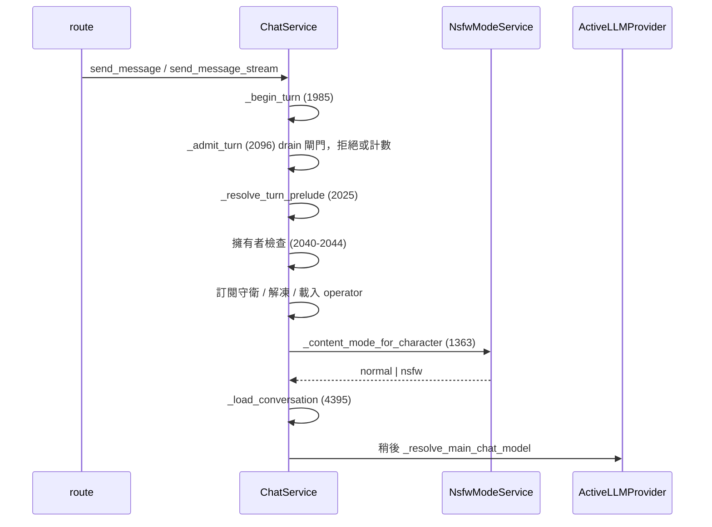
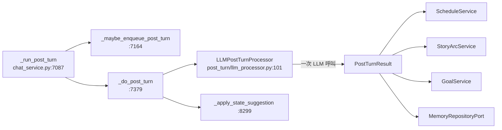

# 流程：聊天回合

`chat_service.py` 有 10,000 行。不要通讀，按這條主線找。

## 兩個入口

| 入口 | 行 | 回傳 |
|---|---|---|
| `send_message` | 2113 | `ChatReplyResponse` |
| `send_message_stream` | 2718 | `(token_stream, StreamFinalizer)` |

兩者共用同一段前置流程，然後分岔。串流路徑把持久化與 post-turn 交給
`StreamFinalizer`。

## 前置流程（兩個入口共用）

| 步驟 | 方法 | 行 |
|---|---|---|
| 1 | `_begin_turn` — 對 drain gauge 准入，失敗釋放 handle | 1985 |
| 2 | `_admit_turn` — 原子地拒絕或計數 | 2096 |
| 3 | `_resolve_turn_prelude` — 載入角色、擁有者檢查、訂閱守衛、解凍、載入 operator、綁定 cloud actor、解析 `presence_frame`、決定 content mode、載入 conversation、message session 檢查 | 2025 |
| 4 | `_content_mode_for_character` — 問 `NsfwModeService`，NSFW 時順便續命 | 1363 |
| 5 | `_ensure_runtime_message_session_available` | 5496 |
| 6 | `_acquire_turn_lease`（非串流路徑） | 2087 |

## 非串流主線 `_send_message_turn` (2160)

**上下文組裝（步驟 1–17，全部在 LLM 呼叫之前）：**

| # | 方法 | 行 | 產出 |
|---|---|---|---|
| 1 | `_load_unified_recent_messages` | 2177 | 按時間合併聊天／feed／主動訊息歷史 |
| 2 | `_prepare_prompt_dialogue_context` | 2180 | 視窗化 + 舊對話摘要 |
| 3 | `_memorialize_feed_reactions` | 2192 | 未讀的讚與留言轉成記憶 |
| 4 | `_select_memories` | 2193 | 語意 + 近因檢索 |
| 5 | `_load_active_goals` | 2200 | 角色目標 |
| 6 | `_load_current_schedule` | 2207 | 當前／即將／剛結束／已完成／待邀請活動 |
| 7 | `_ensure_story_events` | 2210 | 當日 story event |
| 8 | `_describe_calendar` | 2212 | 日曆脈絡 |
| 9 | `_describe_weather` | 2213 | 天氣脈絡 |
| 10 | `_load_world_event_context` | 2214 | 世界事件 |
| 11 | `_load_world_event_recall` | 2217 | 回憶起的世界事件 |
| 12 | `_load_upcoming_day_schedules` | 2220 | 多日展望 |
| 13 | `_ensure_story_arc` | 2223 | arc 與到期 beat（可能建立或推進） |
| 14 | `_load_open_scene_session` | 2227 | 進行中的起幕 |
| 15 | `_load_recent_proactive_messages` | 2230 | 最近由角色發起的訊息 |
| 16 | `_load_recent_feed_posts` | 2233 | 最近的 LumeGram 貼文 |
| 17 | `_read_self_repetition_hint` | 2236 | 反覆自我重複的欄位 |

中間兩步不屬於上下文組裝：

- `_resolve_image_trigger` (2253) + `StageNudgeTurn.resolve` (2260) — 剝掉 `/pic`
  標記、解析 stage nudge
- `_maybe_apply_idle_drift` (2274) — 長期未互動的心情漂移（LLM key `idle_drift`）

**狀態與短路（18–23）：**

| # | 方法 | 行 | 注意 |
|---|---|---|---|
| 18 | `_load_recent_emotion_events` | 2282 | |
| 19 | `_overlay_emotion_on_state` | 2285 | |
| 20 | `_build_pre_turn_journal` | 2291 | undo 快照，**在任何短路之前** |
| 21 | `_maybe_defer_reply` | 2321 | 忙碌延後短路 → 在 2347 提前返回 |
| 22 | `_conversation_repository.save` | 2364 | **先存使用者訊息，再呼叫 LLM** |

**模型解析與生成（23–25）：**

| # | 方法 | 行 | 注意 |
|---|---|---|---|
| 23 | `_resolve_main_chat_model` | 2369（本體 1546） | NSFW 開啟時忽略 payload 的 provider/model；否則走 `active_llm_provider` |
| 24 | `_generate_reply_with_tools` | 2375（本體 4470） | **prompt 組裝 + LLM 呼叫 + tool loop** |

`_generate_reply_with_tools` 是唯一同時碰到 prompt 層與 provider 層的地方。改
prompt 或改 tool 行為都會落在這裡。

**收尾（26–39）：**

| # | 方法 | 行 | 注意 |
|---|---|---|---|
| 26 | state engine `on_assistant_reply` | 2443 | |
| 27 | `_track` | 2445 | 軌跡／指標 |
| 28 | `_character_repository.save` / `_conversation_repository.save` | 2477–2479 | 外部聊天路徑用 CAS append (2483) |
| 29 | `_schedule_nsfw_safe_summary_generation` | 2486 | **背景**，回合不等待 |
| 30 | `_touch_memories` | 2500 | |
| 31 | `_maybe_schedule_tts_pregeneration` | 2501 | |
| 32 | `_run_post_turn` | 2557（本體 7087） | 見下 |
| 33 | `_schedule_outcome_claim_audit` | 2606 | 對外聲明一致性稽核 |
| 34 | `_maybe_schedule_goal_review` | 2619 | |
| 35 | `_maybe_schedule_repetition_check` | 2623 | |
| 36 | `_persist_journal` | 2627 | |
| 37 | `_record_turn_safely` | 2629 | |
| 38 | `_record_llm_usage_safely` | 2681 | |
| 39 | `_finish_scene_turn` | 2697（本體 5788） | 場景收尾判定 + action chips |

## Post-turn 的邊界

**關鍵結構事實：** `LLMPostTurnProcessor` 是純 LLM→DTO 適配器。它
**不做持久化、不呼叫任何 repository**。所有副作用都在 `_do_post_turn` 裡發生，
也就是往上一層。找「為什麼記憶被寫入」時不要停在 processor。

`_do_post_turn` 後續還會跑：`_run_persona_extraction` (7925)、
`_apply_observed_address_changes` (7972)、`_persist_peer_meet_intents` (8051)、
`_persist_message_promises` (8124)、`_maybe_schedule_goal_review` (8348)、
`_maybe_schedule_repetition_check` (8483)。

## 串流路徑的差異

`_start_message_stream` (2783) 重複前置與步驟 1–24，然後：

- `_describe_tools` (2982) + `asyncio.create_task(_generate_reply_with_tools(...))` (3003)
- 額外跑 `_load_prompt_template_overrides` (3127)、`_overlay_emotion_on_state` (3144)、
  `_fetch_address_preference` (3148)、`_resolve_experiment_overlay` (3152)、
  `_resolve_addresses` (3157)、`_load_address_change_lines` (3161)
- 品質閘門：`_reply_quality_gate_required` (3277) → `_review_chat_draft` (3290)
- 持久化與 post-turn 交給回傳的 `StreamFinalizer`

## 不可違反

- 使用者訊息在 LLM 呼叫**之前**就持久化（2364）。這是崩潰恢復的基礎，不要改成
  生成後才寫。
- `_build_pre_turn_journal` 必須在任何短路之前（2291），否則 undo 會缺快照。
- `_schedule_nsfw_safe_summary_generation` 是背景工作，回合不得等待（見
  `invariants.md` §A）。
- 送往 frontier 的歷史必須經 `sanitize_messages_for_tolerance`。
- 每個副作用對 `(turn_id, effect_kind)` 唯一，非冪等工作前先 claim。

## 測試

`chat_service.py` **沒有單一綜合測試檔**。覆蓋刻意拆成約 80 個檔案：

- 模組層：`tests/unit/test_chat_service.py`（31）、`test_chat_service_busy_defer.py`（19）
- harness：`busy_defer_harness.py`、`chat_stream_route_harness.py`、
  `external_chat_turn_harness.py`、`_messaging_harness.py`
- 行為層：`test_chat_tool_use.py`、`test_chat_vision_input.py`、
  `test_chat_turn_lease.py`、`test_chat_drain_gating.py`、`test_chat_idle_drift.py`、
  `test_chat_stage_nudge.py`、`test_chat_reply_quality_gate.py`、
  `test_chat_action_billing.py`、`test_chat_prompt_mirror_dedup.py`、
  `test_chat_world_event_recall.py`、`test_turn_undo*.py`、`test_story_scene_*_turn.py`
- 整合：`tests/integration/test_chat_user_isolation.py`（5）、
  `test_external_chat_turn_route_pg.py`（3）

改一個 turn-path 行為，預期要動「模組檔 + 該行為檔 + 可能一個 harness」。
